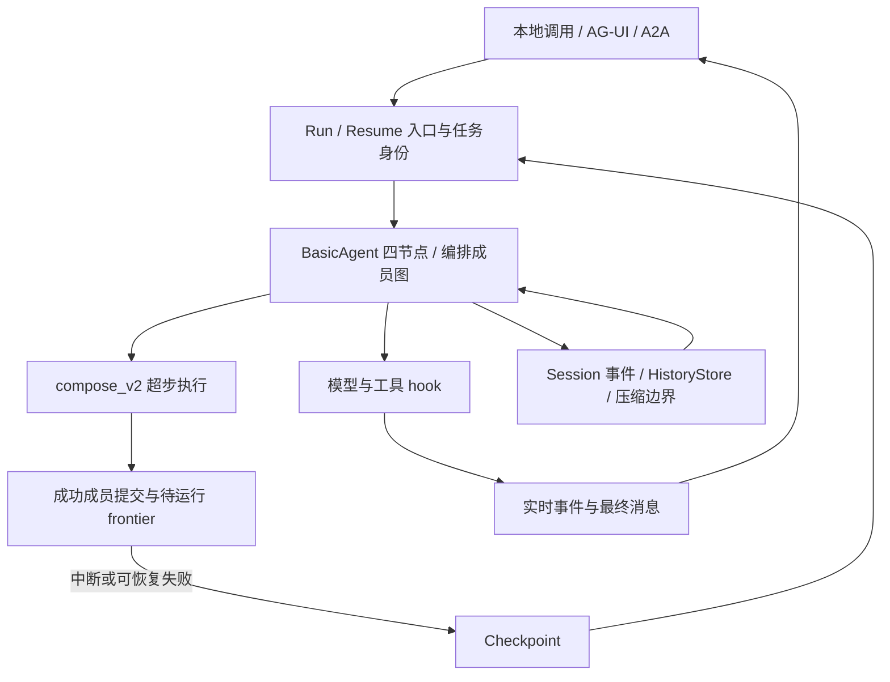

# Agent 与编排流程审计（2026-11-12）

审计基线为 `c2bb512f1b3ac0fb9a67be19cc906b37cabd627a`。以下记录基线行为，修复后的结果见[修复复审](#修复复审)。

确认 **8 项行为问题：1 项 P1、7 项 P2**。其中 Parallel 恢复隔离和 LastValue 跨恢复冲突是本仓已知、仍未闭合的缺口，其余 6 项为本轮确认。另记录 2 项契约或决策改进，以及 3 项优化建议。所有行为发现都有实际探针，主审已独立复跑；不以静态推测计入发现。

## 范围与方法

守住的不变量：**同一任务的中断恢复应保持输入、执行归属、已完成副作用和输出语义；恢复边界不能改变合法输入的可用性，也不能使独立成员互读历史。**

三名独立审计者分别检查图引擎状态所有权、BasicAgent 消息及副作用、编排成员隔离；主审检查接入层并交叉验证发现。覆盖 BasicAgent 和 Sequential、Parallel、Loop、Routing、Handoff、Plan、Reflect、GraphAgent 的主执行入口，重点对抗部分成功、HITL、同名成员、动态成员、hook 改写和恢复。



| 状态 | 生产方与消费方 | 应有寿命与隔离 |
| --- | --- | --- |
| 模型输入改写 | OnModelStart → 压缩与模型 | 本轮视图；不能误写入跨 Run 压缩边界 |
| 模型最终输出 | 模型 → OnModelEnd → channel、事件适配层 | 归属本次调用；聚合结果可随任务或会话持久化，本地与远端最终内容一致 |
| 成员历史 | runMember / runDecisionAgent → BasicAgent | 按成员角色和位置隔离，不能仅依赖展示名 |
| 部分成功记录 | executeFrontier → checkpoint → Restore | 同一逻辑超步跨恢复保留，包含冲突判定所需事实 |
| HITL 问答 | Ask → checkpoint → Resume → 原提问点 | 按执行位置和 InterruptID 配对 |

## 已确认问题

### F1 · P1：OnModelEnd 原地改写后，A2A 最终答复仍是原文

- 位置：[basic_builder.go](../../agent_v2/basic_builder.go)，`OnModelEnd` 调用及 `out != preHookMsg || out.Content != preHookMsg.Content`（基线第 1150–1215 行）。
- 触发：流式模型输出后，合法 hook 执行 `out.Message.Content = "REDACTED"`。
- 原因：所谓改写前消息仍引用同一对象，且取值在 hook 执行之后，检测不到原地变更，未发 replacement 事件。
- 实测：本地 `final="[redacted]"`，已发 chunks 为 `"secret value"`，`replacement_event=false`；真实本机 A2A 服务端经 RemoteAgent 后，最终得到 `"Hello streaming world"`，没有得到 `"REDACTED"`。
- 影响：本地最终消息和远端消费结果不同，输出修正或脱敏结果失效。OnModelEnd 发生在流式发送之后，本来就不能防止原文初次流出；本问题是最终内容也没有被纠正。
- 建议：hook 前保存稳定的原正文和调用身份；hook 后比较值，统一输出 replacement。覆盖原地字段修改、替换对象、annotations 改写以及 A2A/AG-UI 消费。
- 探针：`TestZZAuditInPlaceModelEndRewrite`、`TestZZAuditRemoteAgentInPlaceReplacement`。

### F2 · P2：摘要模型自身的 HITL 无法恢复

- 位置：[autocompact.go](../../agent_v2/autocompact.go)，第 613–619 行 `StripResumeContext` 后调用摘要模型。
- 触发：AutoCompact 的自定义模型在 `Generate` 中通过 `compose_v2.Ask` 请求许可。当前实现允许这类中断向上传播。
- 原因：恢复时摘要调用仍被清掉全部 ResumeContext，自己的答案也被删除。旧隔离理由引用已移除的 `GetResumeAnswerSingle`，没有区分其他调用的答案与自己的寻址答案。
- 实测：按返回 ID 连续 Resume 3 次，仍为同一问题、同一 ID；`summary_calls=4 answered=0 main_calls=0`。同一个模型用作主模型的正向对照成功，`calls=2 answered=1`。
- 影响：任务可正常挂起但永远不能完成，用户反复回答无效。
- 建议：给摘要调用独立执行相位，保留对自身答案的寻址能力；同时验证其他成员答案不可误取，不宜直接无条件撤掉隔离。
- 探针：`TestZZAuditAutoCompactAskResume`，对照 `TestZZAuditPrimaryModelAskResumeControl`。

### F3 · P2：OnModelStart 替换 slice 元素，会把瞬态内容写入跨 Run 压缩历史

- 位置：[basic_builder.go](../../agent_v2/basic_builder.go)，第 1033 行 `streamMsgs := msgs`、第 1115 行边界判定；[compaction_boundary.go](../../agent_v2/compaction_boundary.go) 的 `sameMessageSlice`。
- 触发：启用 AutoCompact 和 HistoryStore，hook 用 `in.Messages[i] = clonedMessage` 修改本轮模型视图。
- 原因：改写前后两份 slice 共用底层数组，替换元素也改掉比较基准；指针相等判据误判为“没有改写”。
- 实测：60 轮 BasicAgent 工具循环，`summary_calls=8 boundaries=8 leaked=8`；8 份已写入 HistoryStore 的压缩边界均包含仅由 hook 加入的 `TRANSIENT-HOOK`。探针使用内存 HistoryStore。
- 影响：后续 Run 的替代历史可能包含本应只在当轮使用的内容；边界读取路径已由源码核对，本探针未执行第二 Run。仓内现有测试只覆盖整体换 slice，未覆盖替换元素。
- 建议：hook 前保存稳定快照或内容摘要；同时检查消息对象原地修改，避免仅复制 slice 后仍共享消息指针。
- 探针：`TestZZAuditHookSliceReplacementLeaksIntoBoundary`。

### F4 · P2：Parallel.Resume 复用原 Session 时，分支可能读取已成功兄弟的历史

- 位置：[parallel_agent.go](../../agent_v2/parallel_agent.go)，第 474–488 行 `siblings` 与 lane 派生。
- 触发：A/B 是同名 BasicAgent，但注册为不同分支；A 完成，B 在 OnAgentStart 中断，随后通过 `WithResumeSession(sess)` 使用原 Session 续跑；未配置独立持久历史读取路径。
- 原因：Resume 重建图时重新创建空 `siblingEvents`；父 Session 已合入上次成功分支的事件，新的隔离表不能识别这些事件的兄弟归属。
- 实测：B 首次进入模型时收到 `[user Q, assistant A-ans, user Q]`，运行本身返回成功；不复用原 Session 的对照只收到 `[user Q]`。
- 影响：本应独立的并行分支被兄弟结果污染，可能改变答案或重复处理输入。
- 已知状态：`doc/code/todo.md` 的相关 lane 项此前已注明 Resume 组合未覆盖；本轮用探针确认仍存在。
- 建议：分支归属不能只存于一次 build 的指针集合，应随 Session/恢复状态保留；同时覆盖新 Session 与原 Session 两种 Resume。
- 探针：`TestZZAuditParallelResumeSiblingIsolation`。

### F5 · P2：Reflect 的同名 actor/evaluator 会混淆会话历史

- 位置：[member_dispatch.go](../../agent_v2/member_dispatch.go)，第 169–176 行内部决策调用共用 Session；[basic_agent.go](../../agent_v2/basic_agent.go)，第 946–954 行无持久历史时按 agent 名过滤 Session。
- 触发：actor 与 evaluator 均使用合法名称 `worker`，没有配置 HistoryStore，Reflect 进入第二轮。
- 原因：`WithoutHistoryCtx` 阻止持久历史写入，但内部评估事件仍进入共享 Session；按名称回读时被视为 actor 自己的事件。
- 实测：第二轮 actor 除了显式构造的反馈输入，还收到 evaluator 的完整评估请求及 `assistant PRIVATE-CRITIQUE`；evaluator 使用不同名称的对照通过。
- 影响：内部评估被冒认为 actor 的既有回答。反馈文本出现在正常的“评审反馈”输入中是预期行为，本问题是额外的 user/assistant 对话与错误角色归属。
- 建议：为决策执行建立独立事件视图和身份，不能仅靠禁止 HistoryStore 写入完成隔离；允许合法同名实例。
- 探针：`TestZZAuditDecisionSessionIsolation`。

### F6 · P2：Plan 临时成员历史槽可与合法注册名碰撞

- 位置：[plan_agent.go](../../agent_v2/plan_agent.go)，注册成员第 890 行 `historySlot: name`，临时成员第 923 行 `historySlot: fmt.Sprintf("tmp_step_%d", globalIdx)`。
- 触发：第 0 步临时成员执行后，再调注册键为 `tmp_step_0` 的成员；启用共享 HistoryStore。成员自身的 Name() 不需要与临时成员相同。
- 原因：框架生成的临时身份与用户注册名处于同一字符串空间。
- 实测：自定义 ExecInputBuilder 只返回“独立任务”，未传前步引用；注册成员仍收到 `[user 临时任务, assistant TMP-PRIVATE-OUTPUT, user 独立任务]`。注册键改成 `normal_slot` 的对照通过。
- 影响：不相关成员互读历史。图 namespace 带 step 序号，不能解决独立 historySlot 的碰撞。
- 建议：按成员种类建立结构化或明确分域的历史身份，注册名与临时步号分开编码；同步更新历史归属契约、调用方和回归测试。
- 探针：`TestZZAuditPlanTmpHistorySlotCollision`。

### F7 · P2：interface channel 可正常执行，却不能从存档恢复

- 位置：[serialization.go](../../compose_v2/serialization.go)，第 811–815 行的精确类型比较。
- 触发：公开 API `LastValue[any]` 写入字符串，后续节点读取并 Ask，然后恢复。
- 原因：Restore 要求具体运行时类型严格等于 channel 声明类型，拒绝本来可赋值给 interface 的具体值。
- 实测：首次写入和读取正常；Resume 报 `cp wire type string vs ChannelManager registered interface {}`，`writes=1 reads=1`，恢复节点尚未执行。
- 影响：自定义 Graph/GraphAgent 使用 interface channel 时，HITL 或失败恢复不可用；当前内建生产 channel 未使用此类型。
- 建议：采用与正常赋值一致的类型兼容判据，测试 `any`、实现接口的类型以及确实不兼容的类型；保留恢复失败回滚。
- 探针：`TestZZAuditInterfaceChannelResume`。

### F8 · P2：LastValue 单写入者规则跨部分恢复失效

- 位置：[graph_loop.go](../../compose_v2/graph_loop.go) 第 2561–2590 行写入者检查；[channel_manager.go](../../compose_v2/channel_manager.go) 第 690 行起部分提交；Checkpoint 缺少已完成成员的写入者记录。
- 触发：同一超步 A/B 都写同一个 LastValue；A 首次业务失败，B 成功；Resume 只重跑 A。
- 实测：无失败对照正确报 `ErrRunAborted`；恢复组合却 `err=nil value=A A=2 B=1`，A 覆盖已提交的 B。
- 影响：同一接线是否被拒取决于是否经过恢复，原应暴露的图配置冲突静默放行。
- 已知状态：`graph_loop.go` 第 1720–1725 行注释已承认该逃逸，本轮不是新回归。成功分支与恢复分支属于同一逻辑超步，信号已有跨恢复合并处理，写入者没有。
- 建议：持久化成功成员的 channel 写入归属，恢复时与本轮成员及 Send payload 一并检查。涉及 Checkpoint 全字段往返，需同步内存、SQL、Redis conformance。
- 探针：`TestZZAuditSingleWriterAcrossResume`，其中 `pause=false` 为正向对照。

## 需完善的决策与优化

以下没有混入上述 8 项缺陷计数。

1. **取消后的存档清理需要可重试路径。** `resume_helpers.go:158–168` 对普通 DeleteSubtree 错误刻意只告警并返回成功；默认进程内 AG-UI 随后移除会话。故障注入实测：取消仍报告 `cancelled`，后端恢复后重试得到 HTTP 404 `no_session`，存档仍在。这符合当前 best-effort 决策，但缺少自动补偿。共享 SessionStore 的自定义 abortCleanup 会传播错误，不属于同一分支。建议明确保留待清理记录或加入可重试清理队列，避免用“取消成功”隐含“存档已删除”。探针 `TestZZAuditAbortFailureRetainsRetryHandle` 的红色断言表达的是建议增强的契约。
2. **压缩失败的控制错误处理应统一。** `basic_agent.go:2841` 附近只传播中断和调用方取消；摘要模型直接返回 `ErrRunAborted` 时，实测主模型仍执行且 Run 成功。todo 已登记同类吞错模式。当前探针直接注入哨兵，尚未证明标准 provider 会自然产生它，因此作为协议防御遗漏处理；建议与 `MustPropagate` 统一并覆盖真实包装调用链。
3. **分开宽度限制和执行并发预算。** 图 `executeFrontier` 和 BasicAgent 多工具批次都按成员数起 goroutine。`WithMaxFrontierWidth` 是终局熔断，不是排队背压。可增加可选的节点/工具并发上限，等待应响应取消，并保持工具结果声明顺序、已完成记账和中断合并。尚未做吞吐压测，不承诺收益数值。
4. **评估工具账的重复序列化成本。** `basic_agent.go:3447–3453` 每完成一个需要记账的工具调用，就在锁内保存增长后的完整 memo；`SaveNodeState` 序列化整份值。等尺寸结果下，累计处理量随进入 memo 的调用数近似二次增长。先测批宽与结果大小，再考虑独立账项或增量编码，不能以延迟全部记账换性能，否则中断后重放副作用。
5. **把身份与快照契约集中起来。** F4–F6 分别暴露归属记录寿命不足、展示名承载历史身份、内部与注册位置编码碰撞，应统一身份编码及其保存期限；F1/F3 则依赖可变对象作为比较基准。建议分别收敛为成员身份和 hook 前快照两处权威实现，再扩展同一套对照测试，避免逐编排增加例外。

建议修复顺序：先 F1；再将 F3/F4/F5/F6 作为消息和历史隔离专题处理；随后 F2/F7/F8。F8 涉及跨后端存档契约，宜单独提交和独立审计。性能项排在行为契约之后。

## 验证与限制

已实际通过：

- `make test`：根模块、`redis/`、`sql/`、`a2a/zk/` 默认测试。
- `make vet`：四个模块静态检查。
- `go run ./example/orchestration/nested_smoke`：12/12。
- `go run ./example/orchestration/channel_smoke`：5/5。
- [Plan Web mock 速查脚本](../description/smoke-test-recipes.md#2-plan_chat_web-mock--hitl-resume30-秒)：SSE 挂起、续跑 final/success、完成后 HTTP 410。
- `go run ./example/a2a/hitl_smoke`：Task 状态、input-required、taskID 续跑、流式、HumanGate 全部通过。

核心包现有 race 测试全部通过，实际命令为：

```bash
go test -race ./agent_v2 ./compose_v2 ./hook ./agui ./a2a/... ./observability ./fallback ./schema -skip '^TestZZAudit'
```

此时探针尚在工作区，使用 `-skip` 排除故意验证缺陷的测试；交付前已归档并删除。新增审计探针的红色结果不属于现有测试失败。探针使用真实 BasicAgent、图引擎和恢复链路，替换的是模型或后端边界。三个编排隔离探针均有正反对照：不带原 Session、独立 evaluator 名、独立注册槽分别通过，反例分别失败。

本轮未调用付费真实 LLM，未重新验证真实 Redis/PostgreSQL/MySQL/ZooKeeper 服务、进程崩溃和长时间租约故障。默认模块测试通过不等于真实外部 backend 验证。没有宣称全项目无其他问题。

## 复现材料

完整临时测试保存在 [复现补丁](agent-orchestration-audit-2026-11-12-probes.patch)，依赖基线已有的测试 helper。工作区不保留故意失败的 `zz_` 测试。

```bash
git apply doc/review/agent-orchestration-audit-2026-11-12-probes.patch
go test ./agent_v2 ./compose_v2 ./agui ./a2a/server -run '^TestZZAudit' -count=1 -v
git apply -R doc/review/agent-orchestration-audit-2026-11-12-probes.patch
```

第二条命令预期失败；主模型 Ask 和无暂停的写冲突对照应通过。无论测试退出码如何，执行第三条命令清理。建议在基线的隔离检出中复现；补丁不包含修复，不应纳入普通 CI 测试集。

## 修复复审

8 项均已修复。复审沿消息所有权、成员归属、超步提交三个独立视角复跑。首次复审发现临时成员的独立 Session 丢失父会话中的执行事件。最终实现保留成员事件，在发布时附上历史路径，并让模型从同一归属读取 Session 与 HistoryStore。

| 范围 | 修复后不变量 | 复查证据 |
| --- | --- | --- |
| F1 | 模型调用身份和原正文由框架持有，原地改写按同一调用发替换事件 | A2A `RemoteAgent` 最终收到改写正文，AG-UI 在两种钩子顺序下收敛到同一答复 |
| F2 | 摘要有自己的执行相位，只能按位置读取自己的答复，任务控制错误向上交付 | 摘要与主模型先后提问并正确结束，摘要内部嵌套提问可续跑，终局错误阻止调用主模型 |
| F3 | 模型钩子持有本轮副本，摘要备忘记录来源视图 | 原地改写和替换元素均进入本轮模型，后续 Run 只读回原始历史。无改写时压缩边界照常写入 |
| F4 | 并行归属随事件提交，范围为同一任务与图 namespace | 原 Session 和 JSON 恢复均隔离兄弟，同时保留调用方前文。无存档的嵌套并行保留两层归属 |
| F5 | 内部决策有独立的会话事件，结果和观测按原调用传递 | 同名 actor 仍收到显式反馈，评估对话不混入 actor 历史。决策的业务 KV、HITL 与路由返回通过 |
| F6 | 临时成员按任务和步骤编码历史位置，注册位置与展示名独立 | 同名及原槽重名的对照在有无 HistoryStore 两档通过，注册成员继续读自己的旧历史，父会话保留临时成员事件 |
| F7 | 存档值遵守 channel 的类型断言语义 | `any` 和 `fmt.Stringer` 的具体类型经 JSON 恢复，错误类型被拒且旧值保持 |
| F8 | 同一逻辑超步的写入归属与完成记录一并持久化 | 多次部分失败后仍拦截两种 member/payload 顺序，同一发送者和下一超步合法写入通过。缺归属时，预加载的 ChannelManager 也不会回写原档 |

基线 8 项复现用例全部出现预期失败。隔离副本中分别移除并行过滤、恢复拒绝写入保护和已完成成员归属，新增回归按预期失败。两个私有态投影测试原来由两个成员写同一 LastValue，现改为 Append 并保留原副作用次数与投影断言。最终复审未发现上述问题的同类复发。

已通过 `make test-all`、`make vet`、`go test -race ./agent_v2 ./compose_v2 ./hook ./a2a/... ./agui ./observability`，以及嵌套 12/12、Channel 5/5、Plan Web SSE 和 A2A HITL 冒烟。实际 PostgreSQL 三种驱动模式、MySQL 两种参数模式、Redis 7.4.2 和默认 SQLite Checkpointer conformance 均通过。真实模型冒烟因缺少 `QWEN_API_KEY` 未执行模型调用。

本轮 8 项修复引入存档格式 v20。含单写入者 channel 的旧部分提交如果缺少 `CompletedWriteOwners`，恢复会拒绝并保留原档。摘要终局错误传播已随 F2 完成。

## 2026-11-13 优化复审

### 取消与清理补偿

存储故障注入复现了 AG-UI 返回 `cancelled` 后丢失任务入口的行为。重试返回 `404 no_session`，存档仍存在。
显式 Abort 现在上报删除错误。进程内 AG-UI 在清档前保留原任务及取消请求的身份，拒绝送回答案，
并由重复取消、同线程新 Run 或容量和 TTL 回收完成清档和历史收尾。
跨租户 TTL 探针使用独立的 `agent_v2.WithHistoryOwnerFunc`，验证补写落在原任务的历史分区，工具体执行数为零。
旧请求的释放按其领取的条目核对。共享 AG-UI 继续通过存储事务原子删除会话与存档。

A2A SDK v2.7.0 实测会绕过已取消任务的 Executor.Cancel，仍调用结束回调。
Executor 以取消记录独占存档清理。首次失败后结束回调补偿，后续 `CancelTask` 也能重试。
实测涵盖在途 Resume 退出后才清档、错误续答被拒、请求已取消时清理期限和身份仍有效。
持续故障下清理依赖下一次重试或回收，默认进程内记录随进程结束。

### 执行并发预算

图超步与 BasicAgent 原先按成员或工具数量创建 goroutine。改后分别用
`compose_v2.WithMaxConcurrentNodes` 和 `agent_v2.WithMaxConcurrentTools` 设置独立预算，默认值均为 0。
限额 2 的屏障探针确认两项真重叠，取消后其余项没有执行。该探针的 Resume 只执行未完成项，输出保持声明顺序。
独立探针覆盖同 NodeID 多实例的输入恢复、限额 1 嵌套图、Goexit 后继续派发及排队工具的取消 span。
已经派发的执行按协作取消收尾。各层预算独立，应用可以按实际嵌套深度估算总并发。

### 工具账编码成本

每完成一项便编码逐渐增大的整批工具账，使固定大小结果的累计编码量按批宽近似二次增长。
改后审批、原始结果和定稿各自更新其调用的账项，保留原有的持久化边界。
v21 首次读取 v20 批次账时迁移。真实 BasicAgent 的 v20 JSON 恢复回归确认已完成的副作用执行一次，
暂停工具复用已批准状态，模型收到两项正确结果。独立复审还覆盖空 ID、工具改名、钩子定稿和信号，
并修复技能参考文档在兄弟工具中断后重复读取的问题。

Apple M1、Go 1.26.4、`GOMAXPROCS=8`，真实 BasicAgent、桩模型及每项 4 KiB 的内存工具输出。
同一基准每档运行三次，表中为中位数。分配列是累计分配字节折算的 MB。

```bash
GOMAXPROCS=8 go test ./agent_v2 -run '^$' -bench '^BenchmarkBasicAgentToolLedger$' -benchmem -benchtime=400ms -count=3
```

| 批宽 | 变更前 ms/op | 变更后 ms/op | 变更前 MB/op | 变更后 MB/op |
|---:|---:|---:|---:|---:|
| 8 | 0.90 | 0.28 | 0.66 | 0.27 |
| 32 | 6.43 | 0.75 | 6.23 | 0.94 |
| 64 | 21.80 | 1.35 | 21.17 | 1.82 |
| 128 | 76.54 | 2.91 | 78.06 | 3.61 |

该基准测量批次执行及内存编码，无外部模型或持久化后端 I/O。
工具体有外部副作用且进程在存档前退出时，业务仍需幂等。

### 交付检查

- `make test-all`、`make vet` 和核心包 `go test -race` 通过。
- 嵌套冒烟 12/12、Channel 冒烟 5/5、Plan Web SSE 和 A2A HITL 冒烟通过。
- SQLite、实际 PostgreSQL、MySQL 和 Redis 的存档 conformance 通过。PostgreSQL 和 MySQL 同时运行共享 AG-UI 会话用例。
- 独立复审后分别关闭六处关键行为进行对照。预算旁路、旧账迁移、A2A 结束回调、回收历史收尾和旧请求释放保护均触发对应失败。
- 本机缺少 Qwen 和 DeepSeek 凭据，教学与 A2A 的真实模型调用未验证。

## 2026-11-13 取消补偿重启复审

真实 SQLite 文件保留存档。第一个子进程触发审批，用数据库触发器使删档失败，然后直接退出。
第二个子进程恢复删除能力并尝试续答或取消。原版的两种配置均复现异常：

| 配置 | 重启后实测 | 根因 |
|---|---|---|
| 进程内 AG-UI 会话配 SQLite Checkpointer | 取消返回 404，根存档仍在 | 任务 ID 映射与存档的生命周期不同 |
| 共享 SQL 会话 | 原题可继续回答，任务推进到下一问 | 同一删除事务失败时，取消意图随之丢失 |

参考本地 Kubernetes 的删除标记与 finalizer，将取消确认拆成有持久状态的三阶段。
在会话租约和任务放弃许可内先保存取消批次，随后原子删除子树并记下清档进度。
历史收尾使用执行时绑定的分区，成功后移除会话记录。续答无法通过关闭状态。
进程内模式要求易失 Checkpointer，SQL 和 Redis 提供共享会话接入。宿主在执行范围内绑定同一个后端。
请求中间件和开始钩子替换 Checkpointer 的路径均用真实 SQLite 验证。AG-UI 的图选项和嵌套执行沿用宿主后端。
A2A 同样复现取消成功后 SQL 档仍存在。Executor 绑定内存 Checkpointer 后，挂起档与任务映射一起随进程退出。

`TestSQLiteAGUICancelSurvivesProcessExit` 验证删档失败、意图提交后回执丢失、落盘后进程退出、历史写入失败和最终确认失败。
实际工具执行数为零，历史只补一条且落在原分区。原回执保持可重放。另有双租约接管、缺旧工作流工厂、旧取消与新任务隔离测试。
历史配置缺失时，取消保留关闭记录等待补写，普通续答保留存档和已采纳的答复。移除取消意图持久化、
历史分区绑定、续答存档保护的三个对照均触发对应回归。
Redis 7.4.2 开启 AOF，使用两个宿主子进程验证补偿。索引类型错误和拒绝 `SREM` 的权限探针均在删除前保留原档。

- `make test-all`、`make vet` 与 `agent_v2`、`agui`、`compose_v2`、`a2a`、`observability`、`sql`、`redis` 的竞态检查通过。
- SQLite、实际 PostgreSQL、MySQL 和 Redis 的 Checkpointer conformance 通过，PostgreSQL 和 MySQL 的共享会话用例同时通过。
- 嵌套冒烟 12/12、Channel 冒烟 5/5、Plan Web SSE 和 A2A HITL 通过。AG-UI 真实模型冒烟遇到 DashScope 401，A2A 真实模型冒烟缺少 `QWEN_API_KEY`。

重启补偿在租约可接管后由匹配的取消重试、同线程查询或新 Run 驱动。旧进程内模式已经丢失映射的存量存档，
只能使用可核实的原任务 ID 定位。历史 Store 自身的写入与会话事务分别提交。
