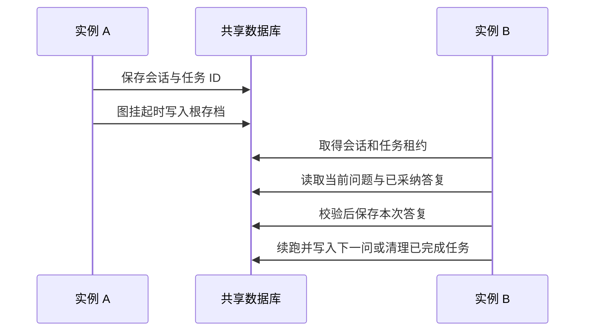

# AG-UI 前端协议适配（`agui` 包）

把 crew-go 的 agent 执行事件适配成 **AG-UI（Agent-User Interaction Protocol）** 标准
事件流，经 SSE 推给前端——业务可直接接 CopilotKit 等 AG-UI 生态的现成前端组件
（React / Vue / Angular），不必为 crew-go 专写前端。

> 决策溯源见 [issue-49](../issue/issue-49-frontend-stream-adapter.md)「2026-07-01 决策修订」
> （推翻早前「不做框架级 SSE」的结论——AG-UI 是对齐外部标准协议，非自定义 SSE 抽象）。

---

## 1. AG-UI 是什么

AG-UI 是 CopilotKit 主导的 agent→前端事件协议（camelCase JSON + Server-Sent Events），
已被 LangGraph / CrewAI / LlamaIndex / Mastra / Pydantic AI / Microsoft Agent Framework
等主流框架接入。定义约 33 种标准事件（`TextMessage*` / `ToolCall*` / `RunStarted/Finished` /
`StateSnapshot` 等）——**一个前端可消费不同后端**。

`agui` 包**内联精简**了 server 端要用的事件类型（字段 / json tag 照协议 wire），**不硬
依赖**官方 community Go SDK（无版本 tag + 引 `logrus`，与 crew-go 的 `slog` 不一致）——
协议是薄层，内联可控，同 `modules/` 拷 spec 的套路。

---

## 2. 快速上手

```go
cp := compose_v2.NewInMemoryCheckpointer() // HITL Resume 用（不做 HITL 可省）
h := agui.Handler(func(hooks hook.Hooks) agent_v2.Agent {
    return agent_v2.NewBasicAgent(
        agent_v2.WithName("assistant"),
        agent_v2.WithModel(m),
        agent_v2.WithToolkit(tk),
        agent_v2.WithHooks(hooks), // ← adapter 必须注入 agent，否则只剩纯文本
    )
}, agui.WithCheckpointer(cp),
   agui.WithOwnerResolver(func(context.Context) string { return "demo" }))
http.Handle("/agui", h)
```

前端把 CopilotKit 的 `runtimeUrl` 指到 `/agui` 即可。请求是 `POST` + `RunAgentInput`
（`threadId` / `runId` / `messages`；`resume` 非空走 HITL 续跑），响应是
`text/event-stream` 的 AG-UI 事件流。

---

## 3. 为什么是 `AgentFactory`（而非直接传 agent）

AG-UI 是 **per-connection SSE**——每个请求的 adapter 绑定各自的 HTTP response。而
crew-go 的 `hook.Hooks` 是**构造期注入**（`RunOption` 无 per-Run hook.Hooks），故每请求
经工厂构造挂独立 adapter 的 agent。BasicAgent 等构造是轻量 builder，每请求构造开销可
接受；业务想复用重资源（model / toolkit / skillbox）在工厂闭包**外**预建、闭包内只 new
agent 引用即可。

---

## 4. 事件映射

adapter（`agui/adapter.go`）一个 struct 同时实现 `hook.Hooks` + `agent_v2.OrchestrationHooks`：

| crew-go 事件源 | AG-UI 事件 |
|---|---|
| `OnNodeEvent`（chunk，带 `run_id`） | `TextMessageStart/Content/End`（按 `run_id` 分消息，切换即收尾旧开新） |
| `OnModelEnd`（Generate 非流式路径） | 补发完整 `TextMessage`——model 不支持 Stream 时无 chunk，最终答案在此不丢。续跑沿用原样的那一遍（`hook.ModelResponseReusedKey`，业务在 `OnModelEnd` 里问人之后）不再发：上一次 run 已经交给前端，再发是同一个 messageId 的第二条——适配层要排在会问人的钩子前面，否则非流式时那次没补发、这一遍也不补 |
| `OnToolStart`（`CallId`/`Name`/`ArgumentsJSON`） | `ToolCallStart` + `ToolCallArgs` + `ToolCallEnd`（参数非流式，一次性发） |
| `OnToolEnd`（`Result`） | `ToolCallResult`（`CallId` 作 `toolCallId` 配对锚点） |
| Run 开始 / 结束 / 出错 | `RunStarted` / `RunFinished` / `RunError` |
| `InterruptError` | `RunFinished(outcome=interrupt, interrupts=[{id, reason, message, …}])`：工具审批 reason=`tool_call`（带 `toolCallId`、`responseSchema` 与 `metadata.options`），没有工具调用 ID 时 `confirmation`；普通提问默认使用 `input_required` 和字符串响应 schema，可用 `compose_v2.AskQuery.ResponseSchema` 覆盖 schema。框架断点使用 `crew-go:breakpoint` |
| `EventSink.Send("state_snapshot")` | `StateSnapshot`（业务 opt-in，见 §6） |
| `EventSink.Send("reset_stream")` | 收尾那条消息；作废时连同这次模型调用的工具调用与结果一起作废（按框架标在工具钩子 `Extra` 上的 `agent_v2.ToolModelRunIDExtraKey` 认），带 `replacement`（`OnModelEnd` 钩子改写了答复）时换成新正文；再发 AG-UI 标准的 `MessagesSnapshot`（请求带来的消息原样 + 这个 run 发出、没作废的消息）纠正前端——连着来的几个撤回与改写攒成一份，在适配层下一次往外写别的事件、或 run 收尾时发，有在途的流式消息时等它们都收尾（落在一条流中间时官方客户端的事件压缩回放把快照排到那条流之后，那条消息回放出来只剩半截），另立即发 `Custom(crew.reset_stream)` 给按 run_id 自管缓冲的前端。**请求没带 messages 时不发快照**（快照之外的消息会被前端丢掉，而适配层不知道它手上有什么），标准前端那时留着旧内容 |
| `OnError` | `Custom`（前端可处理，标准组件忽略） |

> **run 边界（RunStarted/Finished/Error）由 handler 发**，中间事件由 adapter 发——单一
> 所有权，不重复。

---

`context` 的描述和值以及非空 `state` 会以 JSON 补到本次送模的用户消息。BasicAgent 和 LLMPlanner 使用这份临时数据，历史和存档保留原对话。默认会话的 Resume 请求可提供新的本轮数据。共享会话续跑时沿用 Run 时的这份数据。客户端的 system / developer 消息仍按前文规则过滤。[AG-UI 输入类型](https://docs.ag-ui.com/sdk/js/core/types) · [中断原因](https://docs.ag-ui.com/concepts/interrupts#reason-taxonomy)

## 5. HITL 闭环（Resume）

```
Run → 中断 → RunFinished(outcome=interrupt, interrupts=[{id, reason, message, …}])
前端渲染追问 → 用户答 → 带同 threadId + resume=[{interruptId, status, payload}] 续发
→ handler 走 Resume（答案按 InterruptID 命中 ask_user）→ 续跑 → 完成 or 再次中断（多轮）
```

- `resume` 每项对齐**官方 AG-UI ResumeEntry**：`interruptId`（= RunFinished 的
  `interrupt.id`）+ `status`（`resolved` 已答 / `cancelled` 用户放弃）+ `payload`（答案）
  ——CopilotKit 等标准前端按此格式发。
- **resume 列表恰好覆盖挂起的中断**（AG-UI 1.0：每个挂起的中断都要答到或明确放弃，不支持只答
  一部分）：有不是挂起中断的 ID、同一个 ID 出现两次、漏了某个挂起的中断，都返回
  HTTP 400 `invalid_resume`，会话保持挂起，前端改好重发。规范把这条交给前端
  检查，handler 仍然查：同一个 ID 两条时后一条曾覆盖前一条，审批的批准与拒绝取决于数组顺序。
- **payload**：工具审批只认 `true` / `false`、`{"approved": bool}`（对象只能有这一个字段——
  不支持带修改的批准，带 `editedArgs` 的答复不会按原参数执行）与四个选项字符串（词表见
  `agent_v2.NormalizeApprovalAnswer`）；认不出返回 HTTP 400 `invalid_resume_payload`，保留整批挂起项。
  其余提问的字符串原样传给节点，结构化值经 JSON 序列化后传入。
- **答复按任务累积**：同一个任务里采纳过的答复都记着，每次续跑整份交给 Resume。没进工具账的
  提问（`ask_user`、节点里直接 `compose_v2.Ask` 的）续跑时会重问，框架要 Resume 的调用方把答过的
  答案带上；只交这一轮的话，一个节点先后问两问会来回重问、永远答不完。新开任务（同 threadId
  不带 resume 再发）时清空。
- 节点可在 `compose_v2.AskQuery.ResponseSchema` 声明 JSON Schema 对象。它随存档往返，
  由 AG-UI 投影到 `responseSchema`。Handler 在续跑前校验 `resolved` 的 payload。
  字段缺失或类型不符时返回 `invalid_resume_payload`，保留原挂起项。
  允许文档内引用，外部引用报配置错误。工具审批沿用其固定答复格式。
- 全部 `cancelled` 时走 `agent_v2.ResumeActionAbort`，清档后发 `RunFinished(outcome=cancelled)`。
  混合答复中，取消项以 `[用户取消了此项]` 传给节点。
- 默认进程内会话配 `agui.WithCheckpointer` 后支持多轮续跑。同一 `(owner, threadId)`
  在途时第二个请求收到 `busy`。新 Run 替换旧挂起会话时清理旧存档。

- **上限防 OOM**：挂起会话超 `WithMaxSessions`（默认 10000）时淘汰一个空闲会话 + 清其
  cp——防前端放弃中断（关页面 / 断网）导致 sessions map 长跑 OOM。**淘汰按 owner 分摊**：
  份额最大的那个 owner 出账，且**到达者不赢平局**（平局时由发起这次请求的 owner 自己出，
  它没有空闲会话可出就谁也不淘汰）。单租户部署只有一个分区，这退化成全局 LRU、可用会话数
  不打折；多租户下开个新会话就挤掉别人挂起的 HITL 会话这条路是堵死的，连「跑完即走」
  那种份额恒为 1 的请求也挤不动。代价是**上限变软**——实测约 `max(maxSessions, 有挂起
  会话的租户数) + 在途请求数`，而增量挂在**身份数**上（一个身份恰好多占一格，跟它发多少
  请求无关）。详见 `WithMaxSessions` 的 godoc。

### 共享会话

每个实例用同一 SQL 数据库、存档表和相同的 Agent 图定义。`sql.AGUISessionStore.Setup` 建立
会话表、存档表和租约表，`agui.WithSessionStore` 同时给 Handler 提供会话与 Checkpointer。

```go
cp := crewsql.NewCheckpointer(db, crewsql.Postgres{})
sessions := crewsql.NewAGUISessionStore(cp)
if err := sessions.Setup(ctx); err != nil {
    return err
}
mux.Handle("/agui", agui.Handler(build,
    agui.WithOwnerResolver(resolveAuthenticatedOwner),
    agui.WithSessionStore(sessions),
))
```

会话记录由 Handler 在启动 Run 前写入，保存任务 ID、Run 时的调用方前文、临时送模数据和已采纳答复。
框架按任务 ID 写图存档。挂起集合以根存档为准，SSE 和查询接口都从根存档投影。
同一 `(owner, threadId)` 的请求先取得共享会话租约，续跑在任务租约内校验当前中断 ID。
取消还会在放弃许可内复核存档写代。替换或取消时，SQL 后端在一个事务内核对租约、更新会话并清理旧存档。



重连时调用 `GET /agui?threadId=<id>`，仍通过配置的 owner 解析器确定归属。返回
`{"threadId":"...","interrupts":[...]}`，暂无待答问题时 `interrupts` 为空数组。
如果某条当前问题的答复已保存且图还停在该处，响应会带 `acceptedInterruptIds`。
这时可发送同一个 ID、`status:"resolved"` 并省略 `payload`，由服务端重放已采纳的答复。
线程正被驱动时返回 HTTP 409 `busy`。图已进入下一问时，迟到的旧 ID 返回 `invalid_resume`。

共享路径重建 `agent_v2.RunSession`。已准入工具依赖图存档中的调用状态，新调用按当前工具审批规则判定。
挂起上限和 TTL 适用于进程内会话。共享会话写入终态标记后，后续同线程请求会补偿未完成的清理。
如果终态标记本身未能写入，可以在数据库恢复后重新发起 Run 清理上一任务。
进程在形成根存档前退出时，可以用同一线程重新发起 Run 并清理上一任务。

---

## 6. StateSnapshot 业务 opt-in

AG-UI 的 `StateSnapshot` 用于前端渲染 agent 结构化 state（如 CopilotKit
`useCoAgentStateRender`）。crew-go **不自动发**——channel 是异构声明集合、**无统一 state
schema**，且 **Go 泛型 runtime 擦除**拿不到字段 schema（不像 Python TypedDict 能
introspect）。业务想同步 state 在节点内主动发：

```go
compose_v2.GetEventSink(ctx).Send(compose_v2.Event{
    Type: "state_snapshot", Metadata: map[string]any{"snapshot": myBusinessState}})
```

对应 LangGraph 的 `manually_emit_state` 路径（它另有 node-exit 自动发，靠统一 State
TypedDict，crew-go 架构上不适用）。决策见
[state-model.md](../description/three-way-comparison/state-model.md) §六-9。

---

## 7. 非 BasicAgent 编排

任意编排（Sequential / Plan / Reflect / Graph…）都支持——**工厂里把 adapter 挂到每个
sub-agent**（不只顶层），嵌套编排的 LLM 输出才都被捕获：

```go
agui.Handler(func(hooks hook.Hooks) agent_v2.Agent {
    mkStep := func(name string) agent_v2.Agent {
        return agent_v2.NewBasicAgent(agent_v2.WithName(name), agent_v2.WithModel(m),
            agent_v2.WithHooks(hooks)) // ← 每个 sub-agent 都挂 adapter
    }
    return agent_v2.NewSequentialAgent(agent_v2.WithSequentialName("seq")).
        AddStep("s1", mkStep("step1")).AddStep("s2", mkStep("step2"))
}, agui.WithOwnerResolver(func(context.Context) string { return "demo" }))
```

- chunk 走 `OrchHooks` **嵌套继承**：handler 用 `WithCtxOrchHooks(ctx, adapter)` push，
  sub-agent 沿 ctx 自动继承 → sub-agent 的 chunk 也**逐段真流式**（而非只靠顶层
  `OnModelEnd` 一次性补发）。OrchHooks 无需挂每个 sub-agent。
- tool / model 输出走各 sub-agent 的 `hook.Hooks`——`hook.Hooks` 是构造期注入（不走 ctx），
  故 adapter 要挂全，漏挂的 sub-agent 其 tool / 非流式输出不会进 AG-UI 流。

---

## 8. 限制

- **client 断开**：agent 跑期间 client 断开 → `r.Context()` canceled → 框架超步边界停 +
  清 sess（省 LLM/工具开销）；RunStarted 前断开 → 短路不跑 agent。（单个长超步 / LLM 调用
  期间断开需该请求响应 ctx 取消才立即停。）
- **StateSnapshot 不自动**：Go 泛型擦除，业务 opt-in emit（§6）。
- **编排特有语义丢失**：`ForkLane` / Plan replan / 嵌套 ns 在 AG-UI 无原生对应，降级
  `Custom` / metadata 或不映射（AG-UI 前端心智是 message + tool，不需引擎内部结构）。
- **协议演进**：AG-UI 仍在迭代（有 deprecated 如 Thinking→Reasoning），内联协议层需偶尔
  跟版本——但协议薄，加 / 改几个 struct 即可。

---

## 9. 验证

- 单测 [`agui/agui_test.go`](../../agui/agui_test.go)：SSE wire 格式 / streaming 端到端
  （chunk delta 拼回）/ HITL Run→中断→Resume→完成 / 无 cp resume 报错 / 非 BasicAgent
  （SequentialAgent）。
- [共享审批回归](../../sql/agui_session_test.go)覆盖独立连接接手、断流重连、迟到答复、旧取消与租约失效。
- [SOP 示例](../../example/orchestration/sop_demo/main.go)演示结构化审批、校验回退、拒绝及批准后执行。
- 真 qwen 冒烟 [`example/agui/agui_smoke`](../../example/agui/agui_smoke)：① tool + streaming
  ② 多轮 HITL Resume（qwen 调 ask_user 追问 → 中断 → 多轮续发续跑）。

---

## 10. 与 `plan_chat_web` 的关系

`example/orchestration/plan_chat_web` 是**自定义 SSE 参考实现**（内部调试 / 精细场景），事件是 crew-go
自定义格式、非 AG-UI 标准。`agui` 是**对外标准协议**通道（接 CopilotKit 生态前端）。两条
并存不替代——精细内部调试用 plan_chat_web，对接标准前端生态用 agui。
