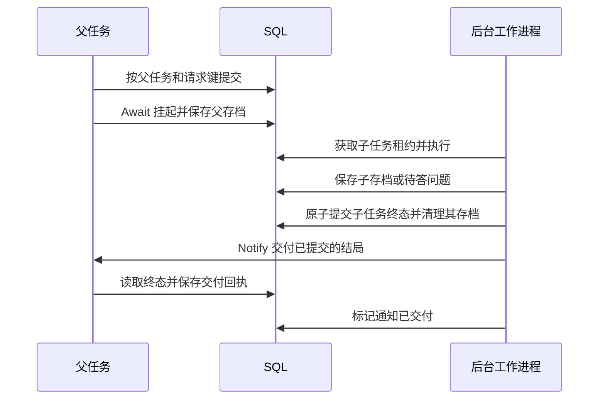

# 可恢复的后台子 Agent

`crew-go/agent_v2/background` 让宿主显式派发独立的 Agent 任务。父任务拿到句柄后可以继续执行或挂起等待。工作进程保存子任务的进度、待答问题和结局。共享同一存储的进程可以接手执行。

派单、补答和取消都按同一份 `background.Parent` 授权。宿主从已认证的调用方取得 `Owner`，在父图节点内用 `background.ParentFromContext` 取当前归属。`TaskID` 是父任务的执行 ID，`ThreadID` 用于唤醒时重建会话上下文。子任务用自己的 `Task.ID` 作为会话和根存档的键。父任务继续按自身运行生命周期管理存档。

## 接入

1. 用 `sql.NewBackgroundTaskStore(cp)` 为 SQL Checkpointer 创建任务存储，部署时调用 `Setup(ctx)`。SQLite、PostgreSQL 和 MySQL 共用这个入口。生产者和工作进程使用同一数据库和 Checkpointer 表名。工作进程可从自己的进程配置取得模型、工具和业务依赖。
2. 用 `background.New(store, cfg)` 创建管理器。为每种任务登记 `Config.Workers`，例如 `report@v1` 对应一个 `background.Factory`。工厂收到执行上下文和子任务 ID，按持久任务所用的版本创建 Agent。滚动升级时保留未完成任务对应的工厂，新任务可用新的工厂名。
3. 由宿主驱动 `Manager.Serve(ctx)`，或在现有调度器里调用 `RunOnce(ctx)`。每个 `Serve` 串行执行，可运行多个工作进程。缺少所需工厂的进程会让该任务留在队列或等待接手。默认每秒轮询，单次执行期限默认两分钟，分别由 `PollInterval` 和 `AttemptTimeout` 配置。
4. 用 `Submit(ctx, parent, requestKey, worker, input)` 派单。为父任务内的一次业务操作分配稳定的 `requestKey`。父节点重放时用同一个键和输入，可拿回存量任务。输入消息新生成的 ID 不影响幂等判定。修改输入、父会话或工厂后复用同一个键会返回 `background.ErrRequestConflict`。

```go
parent := background.ParentFromContext(ctx)
task, err := jobs.Submit(ctx, parent, "monthly-report", "report@v1", schema.UserMessage("生成月报"))
if err != nil {
    return nil, err
}
task, err = jobs.Await(ctx, task.ID)
if err != nil {
    return nil, err
}
// 父节点按 task.Status 处理成功、失败或取消。
```

## 查询、审批和取消

`Get` 通过相同父任务归属查询快照。其他归属和未知 ID 均返回 `background.ErrNotFound`。

| `Task.Status` | 含义与操作 |
| --- | --- |
| `Queued` | 派单已入库，等有对应工厂的工作进程接手。 |
| `Running` | 任务正在执行，或等待工作进程续跑。持久存档提供恢复位置。 |
| `Waiting` | `Task.Pending` 给出已落库的待答问题。宿主读问题、校验业务内容及 `ResponseSchema`，再用 `Answer` 提交当前批次的全部 `InterruptID` 及文本。 |
| `Succeeded` / `Failed` / `Cancelled` | 终态可查询。成功带 `Result`，失败带 `Failure`。终态写入和子任务存档清理使用同一事务。 |

同一批仍为当前批次时，重发完整且内容相同的答复会拿到已接纳的状态。问题推进后，旧批次、部分答复或未知问题 ID 会返回 `background.ErrNotWaiting`。

`Cancel` 持久化取消意图。待执行和挂起任务可由工作进程直接结算，在跑的任务先取消 ctx，再等待 Agent 返回。取消意图与结算按记录版本协调，以先提交的终态或取消意图为准。Agent 和工具应响应 ctx 取消。

## 唤醒父任务



宿主可轮询 `Get`，也可配置 `Config.Notify` 把结局送回父任务。父节点使用 `Await` 时，为父任务配置通知方可读取的持久 Checkpointer。通知方从父存档查找 `Reason` 等于 `background.CompletionReason(task.ID)` 的问题，用原 `InterruptID` 和内容为子任务 ID 的用户消息恢复父任务。`Await` 恢复时读取已提交的子任务结局。

回调可能早于父任务挂起。此时返回错误，留给后续扫描重试。回调的确认也可能丢失，宿主按 `Task.ID` 保存交付回执并去重。回调确认成功后，任务保留终态供查询。宿主按应用需要保存和清理任务记录。

## 恢复边界

同一子任务的执行租约跨进程共享。工作进程用同步存档恢复已完成的超步，用持久记录恢复已接纳的答案。写入首次执行状态或结算状态短暂失败时，持有原租约的工作进程会回读并重试。恢复实例找不到可续存档且任务曾进入执行状态时，将其记录为失败以便查询和排查。若进程在业务副作用之后、该超步存档之前退出，重放可能再次调用这一步。写外部系统的工具用子任务 ID 和业务操作身份作为幂等键。

实际接入路径见 [SQLite 的跨进程恢复和父任务唤醒测试](../../sql/background_recovery_test.go)。[数据库审批和取消测试](../../sql/background_task_test.go) 使用两个连接验证实际审批、补答批次、取消与通知。慢工具转入当前进程后台的接入见 [WithBackgroundTasks](background-tasks.md)。
